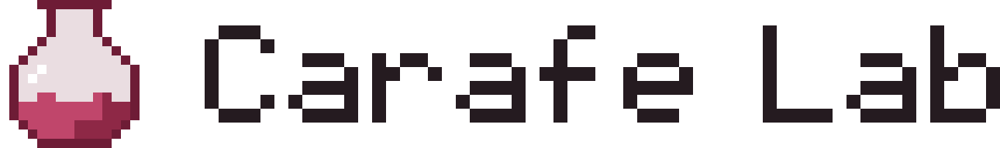

<div align="center">

<picture>
  <source media="(prefers-color-scheme: dark)" srcset="assets/github/banner-dark.png">
  
</picture>

**A test bench for Carafe's development**

[](LICENSE)
[](#requirements)

[](https://www.rust-lang.org)
[](https://tauri.app)
[](https://react.dev)
[](https://www.typescriptlang.org)
[](https://git.eden-emu.dev/eden-emu/eden)
[](https://www.docker.com)

</div>

## What it does

Carafe Lab is a development tool for [Carafe](https://github.com/carafe-nx/carafe). It builds games with Carafe's
runtime, runs them in the [Eden](https://git.eden-emu.dev/eden-emu/eden) emulator in Docker and checks them with
scenarios.

- **Runs of many games** with repeats, the emulator's live picture in the window and a report with screenshots,
  milestones and logs.
- **Every Carafe version compared**: time to the first frame, FPS, the worst frames and memory, with the spread
  between repeats; a game that got slower than its threshold fails.
- **The commit that broke a game**, found by halving Carafe's history; the runtime of each release is built once and
  kept, so a game can run on main against a release.
- **Logs that explain a failure**: the thread stacks of a hung game, where a game crashed, one timeline for all logs,
  and a second run with detailed logs after a failure.
- **Scenarios**: presses, waits, screen checks, repeats and "if the screen shows", recorded by playing by hand and
  drawn as a flowchart.
- **Ready NSPs and the console**: an NSP made by Carafe runs as it is or is built again; NSPs built for the console
  get the console's verdict in the history.

## How it works

1. **Add the games** to the library: drop a Windows game folder on the window.
2. **Pick a plan**: a set of games, your own list with repeats, or an A/B run between two settings or two runtimes.
3. **Run.** Lab packs each game with Carafe's runtime, starts one Eden for the run in Docker, plays the game's
   scenario and writes what it found into the history.

Eden runs in a Linux container and draws on the PC's graphics card through WSL2 with Mesa's d3d12 driver. Lab's
patches to Eden add a control channel for booting, stopping, pressing buttons and taking pictures, so one Eden serves
the whole run.

## Requirements

- Windows 10 or 11 with WSL2 and Docker Desktop.
- A [Carafe](https://github.com/carafe-nx/carafe) checkout with its runtime built.
- The games you check, which you own.

## Building from source

Lab builds on Windows with Git, Docker Desktop, Node.js and Rust:

```
git clone https://github.com/carafe-nx/carafe-lab
cd carafe-lab/app
npm ci
npm run dev
```

Before the first run Lab needs Eden and Mesa built in their containers; the first Eden build takes about an hour. The
steps, and how to write `lab.json` and scenarios, are in [docs/lab.md](docs/lab.md).

## Credits

Carafe Lab stands on the work of others:

- [Eden](https://git.eden-emu.dev/eden-emu/eden) — the Switch emulator Lab runs games in;
- [Mesa](https://www.mesa3d.org) — OpenGL on the PC's graphics card through its d3d12 driver;
- [noVNC](https://novnc.com) — the emulator's live picture in the window;
- [Tauri](https://tauri.app) — the desktop app.

## Legal

Carafe Lab is made for games you own. It ships no firmware or games and does not help to obtain them.
Carafe Lab is not affiliated with or endorsed by Nintendo.

## License

Carafe Lab is [GPL-3.0-or-later](LICENSE). The patches in `patches/` keep the license of the code they change:
GPL-3.0-or-later for Eden, MIT for Mesa. Third-party code in `external/` keeps its own licenses.
